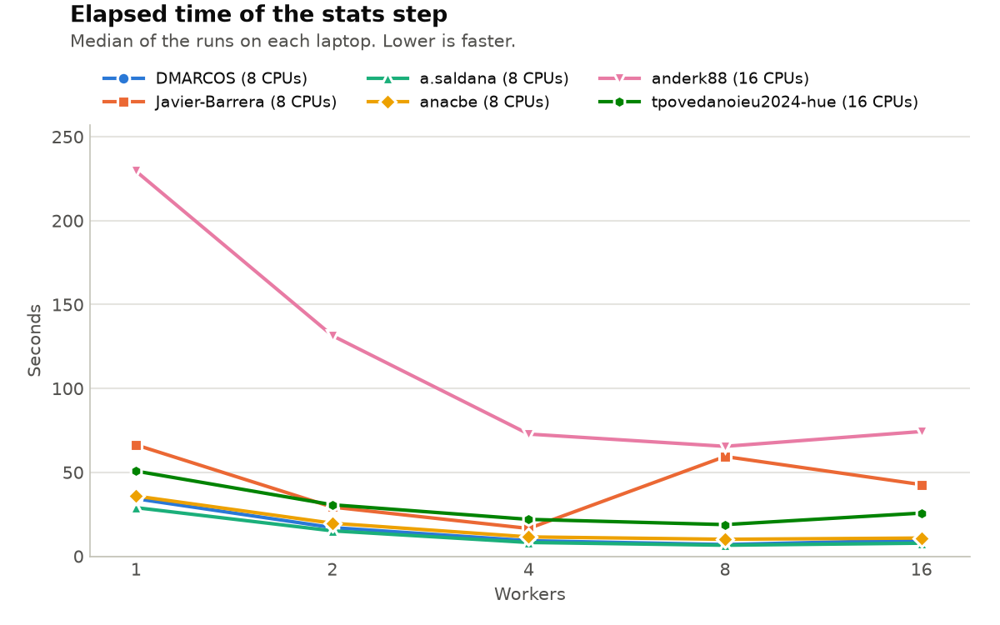

# Lab 1: The Nightly Report

Write your answers in this file. Keep them short: a few sentences, the commands
you used, and the numbers you measured. Copy the lines of output that matter,
not whole screens.

## Warm-up: Generating the report

*Fixed by Javier-Barrera (commit `d1476ae`).*

- What happened, and why: on a Mac, `./run_report.sh` failed with "Permission denied",
because git stored the file as `100644`, without the execute bit (`x`) for owner, group and others.
On my Windows laptop it ran anyway, because Docker shows every file in a Windows folder as `rwxrwxrwx`. 
`bash run_report.sh` always works, because then bash is the program being run and it only needs to read the file.
- Your fix, and how it reached your teammates: `chmod +x run_report.sh` in the container, plus `git update-index --chmod=+x run_report.sh`
on Windows (git on Windows does not see file modes). The commit showed `mode change 100644 => 100755`.
Teammates got it with `git pull`: on Ana's Mac, `ls -l` then showed `-rwxr-xr-x` and `./run_report.sh` started without "Permission denied".

## Task 1: Generating the report… again

*Fixed by anderk88 (Ander Krause). Measurements on an Acer Aspire A315-44P,
AMD Ryzen 7 5700U, Windows 11 Home.*

- Symptom: `./run_report.sh` printed
  `./run_report.sh: line 10: 53 Killed python3 steps/report.py`, then carried
  on and printed `Nightly report finished`. `revenue_by_region_month.csv` was
  missing. Run alone, `python3 steps/report.py` printed
  `report: loaded 8,400,000 orders (887 MiB)`, then `Killed`, with exit status 137.
- Commands and recordings you used, why you chose them, and what they showed:
  `echo $?` right after the step gave 137 = 128 + 9: the program did not
  stop by itself, it was ended by signal 9 (SIGKILL), which it cannot catch.
  `cat /sys/fs/cgroup/memory.events` showed `oom_kill 2`: the kernel's
  out-of-memory killer ended it because the container reached its 2 GiB limit
  (`memory.max`). `/usr/bin/time -f "$T"` on the first 1, 2 and 4 million
  orders (`head -n`) showed how the peak memory grows with the input:
  506 MB, 849 MB and 1,566 MB, about 358 MB per million orders. The whole file
  would need about 3.1 GB. With `| tee /tmp/report.log` the log was empty:
  stdout into a pipe is block-buffered, and SIGKILL ended Python before it
  flushed the buffer.
- Cause: the script loads the whole file, with every column, into one
  DataFrame (887 MiB). It then adds a datetime column and a revenue column,
  builds 12 monthly copies with boolean filters and joins them back with
  `pd.concat`: a second full copy of the data. The peak is about 3.5 times
  the table size, so on 8.4 million orders it goes over the 2 GiB limit,
  even though the table itself is well below 2 GB.
- Fix: `steps/report.py` reads the file in chunks of 1,000,000 orders
  (`pd.read_csv(..., chunksize=1_000_000)`), keeps only the 4 columns it
  needs (`order_date`, `region`, `quantity`, `unit_price`), adds up the
  revenue per region and month of each chunk, and sums the chunks. It no
  longer builds the monthly copies. Memory now depends on the chunk size,
  not on the size of the file.
- Before and after (your measurements), `/usr/bin/time -f "$T" python3 steps/report.py`:

  | | Before | After |
  |---|---|---|
  | Result | `Killed`, exit 137 | `report: done`, exit 0 |
  | Elapsed | 59.02 s | 20.97 s |
  | User / system | 46.02 s / 14.00 s | 19.53 s / 3.32 s |
  | Peak memory | 2,089,756 KB (at the limit) | 381,848 KB |
  | Log with `tee` | empty | both lines |
  | `tools/check.py` | missing | PASS |

## Task 2: Extracting data

*Fixed by DMARCOS (commit `14ddba1`). Measurements on Apple MacBook Air M2.*

- Symptom: `bash steps/extracts.sh` printed `extracts: done` and exited with
  status 0 (program claims there was no problem) but the six files in `~/data/out/extracts` were all 0 bytes.
  `tools/check.py` reported `0 rows, expected 2,183,057` for Iberia and also the same for every region.
- Commands and recordings:`less steps/extracts.sh` showed that the script does `cd "$OUT/extracts"`
  before it reads the data. I ran the pipeline by hand from that folder but
  without `2>/dev/null`, to see the grep's error and the status of
  every command in the pipe:
  ```
  $ cd ~/data/out/extracts
  $ grep ",Iberia," ../data/sales_2025.csv | cut -d, -f1,2,4,6,7 | wc -l
  grep: ../data/sales_2025.csv: No such file or directory
  0
  $ echo ${PIPESTATUS[@]}
  2 0 0 #grep fails but the other steps in the pipeline don't so pipeline exit status is 0
  $ pwd
  /home/analyst/data/out/extracts
  ```
- Cause: three issues. (1) Relative path. We are in folder~/data/out/extracts. We write the path ../data/sales_2025.csv which point to ~/data/out/data/sales_2025.csv which doesn’t exist. The real file is ~/data/sales_2025.csv .
(2) `2>/dev/null`
  hides grep's error message. grep can’t find the file so it writes grep: ../data/sales_2025.csv: No such file or directory to stream 2. Then stream 2 points to /dev/null, so the message vanishes (in the "black hole"). Finally, grep writes nothing to stream 1 so cut receives empty input and writes an empty Iberia.csv without any problem.
  (3) The exit status. In pipeline the exit status is the status of its last command. grep failed but `cut` didn't have any problem (it read an empty input and exited 0).
- Fix: Change so that script reads the file named from absolute path. (`$HOME/data/sales_2025.csv`, absolute path) and then writes to
  `$OUT/extracts/$region.csv`. We removed `2>/dev/null`
  and added `set -euo pipefail`. `-e` stops the script when the first command fails, `-u` treats an unset variable as an error, and `pipefail` makes a
  pipeline fail when any of its commands fails (not only the last one).
- Before and after measurements:

  | | Before | After |
  |---|---|---|
  | Elapsed | 0.01 s | 2.94 s |
  | User / system | 0.00 s / 0.00 s | 3.94 s / 0.87 s |
  | Peak memory | 6376 KB | 8392 KB |
  | Output | 6 empty files, exit 0 | 8,400,000 rows in 6 files (about 290 MB), exit 0 |
  | Input file missing (`DATA=/nope.csv`) | `extracts: done`, exit 0 | `grep: /nope.csv: No such file or directory`, exit 2 |
  | `tools/check.py` | FAIL, 0 rows | PASS for all six regions |

  Before was fast because it did not work.

## Task 3: Auditing
**Fixed by t.povedano**

Prediction: 
1–2 s for 100k and 1 minute for 8.4M; result after fix: 0.66 s for 100k, 21.68 s for 8.4M.
- Symptom:
audit.py was slower than necessary and made ~100,000 openat, write, and close syscalls on the 100,000‑row sample (one open/write/close per order).
- Commands and recordings you used, why you chose them, and what they showed:
1. Timing: T='...' ; /usr/bin/time -f "$T" python3 steps/audit.py (shows elapsed/user/system time and peak memory).
2. Syscalls: strace -c -e trace=openat,write,close python3 steps/audit.py (counts kernel calls; showed one open/close per row before the fix).
- Cause:
The code opened and closed the output file inside the per‑order loop (with open(path,"a") inside the loop), causing enormous syscall overhead.
- Fix:
Open the output file once (with open(path,"w") as f:) and write all lines through the same handle (buffered I/O).
- Before and after (your measurements):
Before: 2.18 s elapsed, 3.28 s user, 0.64 s system, 135704 KB peak
openat 100689 (17 errors), write 100001 (17 errors), close 100677
After: 0.66 s elapsed, 2.30 s user, 0.11 s system, 135488 KB peak
openat 689 (17 errors), write 17, close 677
- Q2. Whole file timing (after fix): 21.68 s elapsed, 23.09 s user, 0.33 s system, 641072 KB peak memory. The kernel share is about 0.33/(23.09+0.33)≈1.4%, much lower than before the fix (when many syscalls pushed time into system). Compared with report.py (system share about 0.39/(7.94+0.39)≈4.7%), audit.py now spends a smaller fraction of time in the kernel.
- Q3. Not really—closing the file doesn’t guarantee the data is physically on disk; without fsync() it can still be in the OS page cache.
- Q4. With one open file, the number of write() syscalls is roughly 
⌈file size/128 KiB⌉ (plus small overhead), not one per order.

## Task 4: Segmenting the orders

**Fixed by a.saldana**

- Symptom: The segments step took 1.081 seconds on 100,000 orders, which would mean ~90 seconds on the full 8.4 million orders.
- Commands and recordings you used, why you chose them, and what they showed: 
  - `DATA=~/data/sales_2025_sample.csv python3 -m cProfile -s tottime steps/segments.py` - profiler showed `_strptime` was called 100,000 times (0.266 seconds), indicating row-by-row date parsing.

- Cause: The `segment(order)` function used `datetime.strptime(order.order_date, "%Y-%m-%d")` for every single order inside a loop. Row-by-row date parsing is very slow compared to vectorized pandas operations.
- Fix: Replaced with vectorized pandas operations: used `pd.to_datetime()` for the entire column, then computed quarter, value, and size using pandas vectorized operations instead of iterating through rows.
- Before and after (your measurements):
  - Before: Elapsed 1.081 s, User 1.073 s, System 0.000 s
  - After: Elapsed 0.27 s, User 0.85 s, System 0.03 s, Peak memory 148028 KB
  - Improvement: 4x faster (75% reduction in elapsed time)

## Task 5: Computing the statistics
**Fixed by anacbe**
- Symptom: There were two problems. (1) The script always used 16 workers, but more workers stopped helping: in my sweep, 4 workers took 11.9 s and 8 or 16 workers both took about 10.9 s, while user CPU time rose from 45 s to 77 s. (2) After Ctrl-C the script stopped, but its workers kept running at 99% CPU.
- Commands and recordings you used, why you chose them, and what they showed:`bash tools/sweep.sh anacbe` to time 1, 2, 4, 8 and 16 workers (averages of 3 runs: 34.3 s, 19.5 s, 11.9 s, 10.9 s, 10.9 s). `less steps/stats.sh` to read the script. Then I started it, pressed Ctrl-C and listed the processes:

  ```
  $ WORKERS=2 bash steps/stats.sh
  stats: input ready
  ^C
  $ ps -ef
  UID      PID  PPID  C  CMD
  analyst    1     0  0  /bin/bash -l
  analyst 2070     1 99  python3 steps/stats_worker.py 0 2
  analyst 2071     1 99  python3 steps/stats_worker.py 1 2
  ```

  The workers were still running, and their parent (PPID) was 1: the script had died and they had become orphans.
- Cause:(1) `WORKERS=${WORKERS:-16}` is a fixed number that ignores how many CPUs the laptop has. The container has 8 CPUs, so 16 workers just take turns on the same cores, and on the M1 only 4 cores are fast, so the curve flattens after 4. (2) The workers are started in the background with `&`. In a script, bash starts background processes with SIGINT ignored, so Ctrl-C killed the script but not the workers, and the script had no `trap` to stop them.
- Fix:(1) `WORKERS=${WORKERS:-$(nproc)}`, so the default matches the CPUs of each laptop and can still be overridden with `WORKERS=`. (2) Before starting the workers: `trap 'kill $(jobs -p) 2>/dev/null; exit 130' INT TERM`. On Ctrl-C or `kill`, the script sends SIGTERM (which the workers do not ignore) to all its background jobs and exits with 130 (128 + 2). Limitation: `kill -9` (SIGKILL) cannot be caught, so the trap does not run and the workers would still be orphaned. 
- Before and after (your measurements):| | Before | After |
  |---|---|---|
  | Workers (default) | 16 | 8 (`nproc`) |
  | Elapsed | 10.9 s | [fill in] s |
  | User / system | 77.5 s / 4.2 s | [fill in] s / [fill in] s |
  | Peak memory | – | [fill in] KB |
  | Ctrl-C | workers keep running with PPID 1 | no workers left, exit 130 |
  | `tools/check.py` | PASS stats.csv | PASS stats.csv |

  Before values are the averages of my sweep with 16 workers. The elapsed time barely changes, but the same result now needs fewer processes.

## The worker experiment

Every member runs `tools/sweep.sh` on their own laptop. Then run
`python3 tools/plot_sweep.py` and commit `results/sweep.png`.



- How does the elapsed time change with the number of workers on each laptop?

  -  1 worker ~67.9 s, 2 ~29.2 s, 4 ~16.5 s (fastest), 8 ~57.7 
  s, 16 ~42.2 s. Faster up to 4 workers, then much slower and less stable,
  with system time up to 327 s.

- Why do the curves of your laptops differ? Use the cores and threads of each
  laptop, listed in `TEAM.md`.
  
  - Snapdragon X Plus, 8 cores and 8 threads (one thread per core). 
    Even so, the fastest was 4 workers, not 8: beyond 4 the system time explodes, 
    so the extra workers make it slower.
  
- Which default number of workers did you choose for `stats.sh`, and why?

  -  We chose 6, because in our sweeps 6 workers was the fastest or close to the
  fastest on every laptop (on mine: ~16.5 s, against ~58 s with 8 and ~42 s with 16).
  Beyond that the system time explodes and the step gets slower. `WORKERS=N` still overrides it.

## Use of generative AI

- **Diego (DMARCOS)** used (Anthropic, Claude Code in the terminal) as a
  supporting tool. Prompts summary: "help me understand the lab step by step, what do I have to do in each step and why", "I have to do the fix for extracts.sh, explain the error/s and how to do the fix", "Why it ives this error". Claude mainly helped me understand everything I was doing along the way. It ran the measurement commands in the container and created the table for the report (which I obviously checked). It tested the fix of `steps/extracts.sh` (the script has a comment).

- **Ander (anderk88)** used Claude (Anthropic) as a supporting tool.
  Prompts summary: "explain step by step what I have to do", "help me fix
  report.py". Claude explained the commands, helped write the fix of
  `steps/report.py` (the script has a comment) and helped write up my
  measurements and the Task 1 section. I ran all the commands, checked the
  results and committed the files myself.

- **Asís (a.saldana)** used Claude (Anthropic, via nebulaONE chat interface) as a supporting tool. Prompts summary: "Help me understand where to run commands (Mac vs Docker terminal)", "How to fix git merge conflicts", "Explain the performance issue in segments.py", "How to use cProfile to profile the code". Claude helped me:
	- Understand the Docker/Mac terminal separation and where to run git vs Python commands
	- Identify the performance bottleneck in segments.py (datetime.strptime called 100,000 times)
	- Create the vectorized pandas solution using pd.to_datetime() 
	- Navigate git conflicts when teammates pushed change
- **Ana (anacbe)** used Claude (Anthropic, claude.ai chat) as a supporting tool. Prompts summary: "help me set up the SSH key and git", "which terminal do I use, the Mac or the container", "explain this output", "what do I write in measurements.md", "help me find and fix the problems in stats.sh", "help me format REPORT.md". Claude helped me:
  - Set up git and the SSH key, and understand the difference between the laptop terminal and the container
  - Analyse my sweep results and find the two problems in stats.sh
  - Propose the two fixes (`$(nproc)` and the `trap`), which I tested in the container before committing
- **Javier (Javier-Barrera)** used Claude (Anthropic, claude.ai chat) as a supporting tool. Prompts summary: "help me set up the lab and go through the in-class tasks step by step".
  - Set up Docker, git and the SSH key on Windows
  - Understand command outputs (exit status 137, memory.events, strace, PIPESTATUS)
  - Fix the run_report.sh permission on Windows (git update-index --chmod=+x)
  - Draft my measurements.md and my warm-up section
